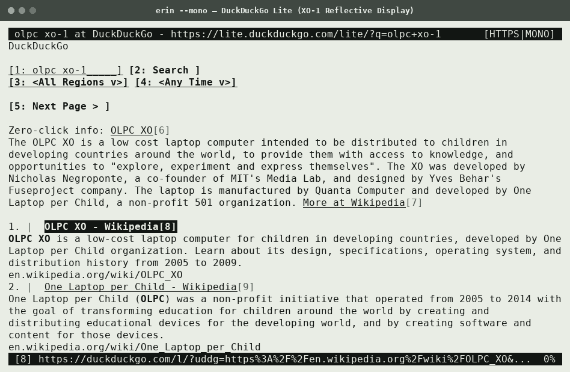
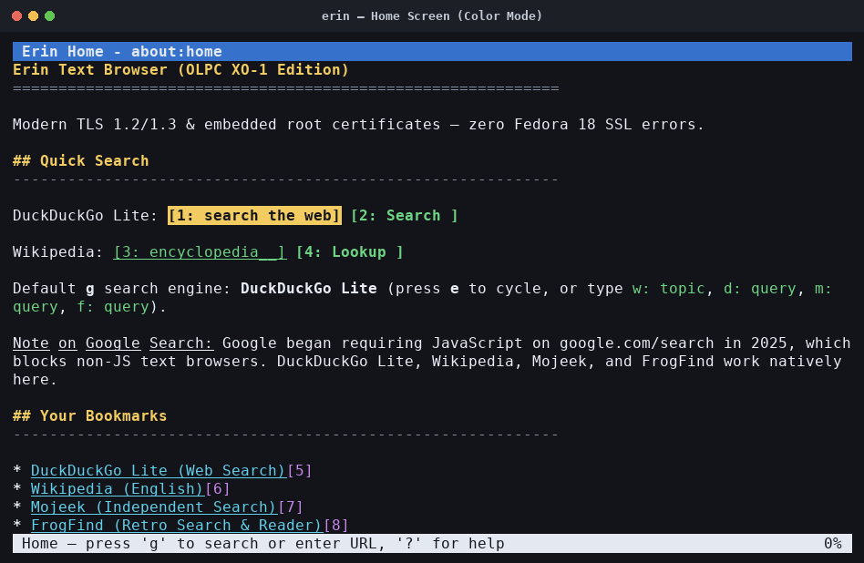
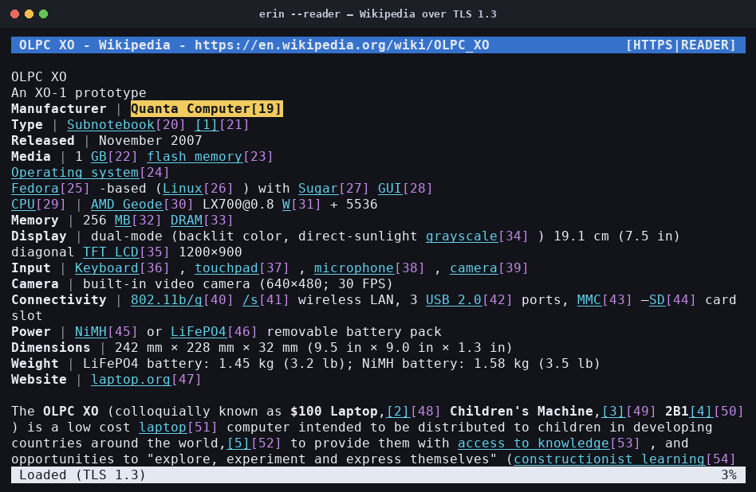
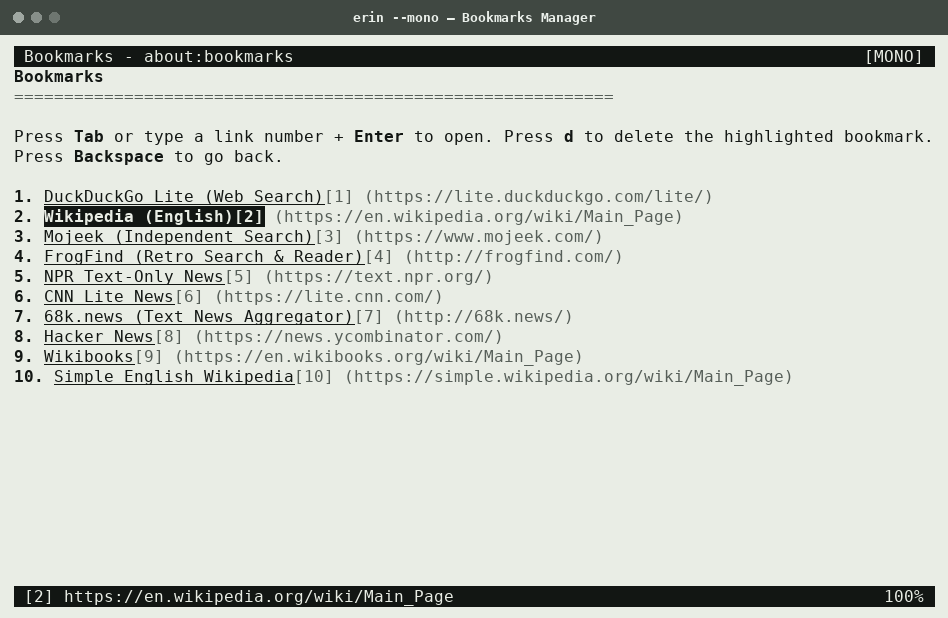

# Erin Browser

**Erin** is a lightweight, self-contained, modern text-mode web browser built specifically for the **OLPC XO-1** running **Fedora 18 / OLPC OS 13.2.x** (and any other 32-bit or 64-bit Linux terminal environment).

It solves the two biggest blockers that make `lynx` unusable on an XO-1 today: **broken 2013-era SSL/TLS & expired CA certificates**, and **websites rejecting `Lynx` or drowning small screens in modern navigation clutter**.

---

## Screenshots

### Monochrome Mode — DuckDuckGo Lite Search (XO-1 Reflective Sunlight Display)


### Home Screen (Color Mode)


### Wikipedia over TLS 1.3 in Reader Mode


### Bookmarks Manager (Monochrome Mode)


---

## Table of Contents

- [Screenshots](#screenshots)
- [Why Erin?](#why-erin)
- [Features](#features)
- [Hardware & OS Compatibility](#hardware--os-compatibility)
- [Installing on an OLPC XO-1](#installing-on-an-olpc-xo-1)
- [Usage & CLI Options](#usage--cli-options)
- [Keyboard Shortcuts](#keyboard-shortcuts)
- [Search Engines & Note on Google Search](#search-engines--note-on-google-search)
- [Configuration & Bookmarks](#configuration--bookmarks)
- [Building from Source](#building-from-source)
- [Project Architecture](#project-architecture)
- [Troubleshooting (XO-1 Tips)](#troubleshooting-xo-1-tips)

---

## Why Erin?

The OLPC XO-1 is an iconic, rugged little machine, but browsing the modern web on Fedora 18 is painful out of the box:

- **Expired SSL/TLS stack**: Fedora 18 shipped in 2013 with `OpenSSL 1.0.1` and a CA bundle that predates Let's Encrypt (`ISRG Root X1`) and modern root CAs. Stock `lynx` fails TLS handshakes on most of today's web.
- **Ancient system libraries**: Fedora 18 runs `glibc 2.16` and Linux kernel `3.3.x`, so modern prebuilt Linux packages fail to start.
- **No SSE2 on the AMD Geode LX-700**: Most modern 32-bit x86 (`i686`) binaries assume SSE2 and crash immediately with `Illegal instruction (SIGILL)`.
- **Tight memory & flash**: With 256 MB RAM and 1 GB NAND flash, graphical browsers and JavaScript engines are impractical.

**Erin sidesteps all of these problems in a single ~8 MB static binary** with zero runtime dependencies.

---

## Features

- **Modern HTTPS built in**: Pure-Go **TLS 1.2 & TLS 1.3** stack with an **embedded up-to-date Mozilla CA root certificate bundle** (`//go:embed`). Completely ignores Fedora 18's expired `/etc/pki/tls/certs/ca-bundle.crt`.
- **Zero Fedora 18 dependencies**: Statically linked (`CGO_ENABLED=0`) — does not require `glibc`, `OpenSSL`, `libcurl`, or `ncurses`.
- **Geode LX-700 safe**: Cross-compiled with `GOARCH=386 GO386=softfloat`, emitting zero SSE/SSE2 instructions.
- **Monochrome Mode (`--mono` or `m`)**: Designed specifically for the XO-1's high-resolution reflective sunlight screen. Emits **zero ANSI color escape codes**, using crisp bold, underline, and reverse-video styling instead.
- **Persistent Bookmarks (`b` / `a`)**: Saved as human-readable JSON in `~/.config/erin/bookmarks.json`, preloaded with informative, text-friendly sites.
- **Reader Mode (`r`)**: Heuristic main-content extraction that strips navbars, language pickers, sidebars, and footers (including dedicated Wikipedia/MediaWiki cleanup) so you jump straight to the article.
- **Standards-compliant HTML5 & Forms**: Renders headings, paragraphs, lists, blockquotes, `<pre>`/`<code>`, tables, numbered links (`[1]`, `[2]`, …), and interactive HTML forms (text/search inputs, password masking, checkboxes, radio buttons, `<select>` dropdowns, GET/POST submission). Single-box search forms auto-submit when you press `Enter`.
- **Modern Networking**: HTTP/1.1 & HTTP/2, transparent `gzip`, `deflate`, and `br` (Brotli) decompression, session cookie jar, automatic redirect handling, HTML charset detection (`UTF-8`, `Windows-1252`, `ISO-8859-1`, etc.), and configurable User-Agent presets.
- **Low Memory Footprint**: Caps individual page downloads at 6 MB and bounds in-memory history to 30 pages so it stays well within 256 MB RAM.
- **Pure ANSI/VT100 TUI**: Works cleanly in the Sugar Terminal activity, Fedora Linux virtual consoles (`Ctrl+Alt+F1`), `xterm`, and over SSH.

---

## Hardware & OS Compatibility

| Target | Supported | Notes |
|---|---|---|
| **OLPC XO-1** (AMD Geode LX-700, 433 MHz, 256 MB RAM) | Yes | Use `erin-xo1-linux-i386` (`GO386=softfloat`, no SSE2) |
| **OLPC XO-1.5** (VIA C7-M, 32-bit x86) | Yes | Use `erin-xo1-linux-i386` |
| **Fedora 18 / OLPC OS 13.2.x** (Linux 3.3+) | Yes | Requires Linux kernel >= 3.2; zero library dependencies |
| **Any 32-bit x86 Linux** (Pentium MMX / i586+) | Yes | Static ELF binary, no `glibc`/`OpenSSL` required |
| **64-bit x86_64 Linux** | Yes | Build native binary with `./build.sh` or `make host` |

---

## Installing on an OLPC XO-1

### Option 1: Copy over the network (`scp`)

From the machine where you built Erin:

```bash
scp dist/erin-xo1-linux-i386 olpc@<xo-ip-address>:~/erin
```

### Option 2: Copy via USB flash drive

1. Copy `dist/erin-xo1-linux-i386` onto a FAT32 USB thumb drive.
2. Plug the USB drive into the XO-1, open **Terminal** (in Sugar) or switch to a virtual console (`Ctrl+Alt+F1`), and copy it to your home directory:

```bash
cp /run/media/olpc/*/erin-xo1-linux-i386 ~/erin
```

### Make executable and run

```bash
chmod +x ~/erin
sudo mv ~/erin /usr/local/bin/erin   # optional: install system-wide

# Launch in Monochrome Mode (recommended for XO-1 reflective sunlight screen)
erin --mono

# Or open a page or search directly
erin --mono https://en.wikipedia.org/wiki/OLPC_XO
erin --mono --reader "AMD Geode LX"
```

---

## Usage & CLI Options

```text
erin [options] [url-or-search]
```

| Flag | Default | Description |
|---|---|---|
| `--mono` | saved config | Start in strict Monochrome Mode (zero ANSI color codes) |
| `--color` | saved config | Start in 16-color ANSI mode |
| `--reader` | saved config | Start with Reader Mode enabled |
| `--engine <id>` | `ddg` | Default search engine: `ddg`, `wiki`, `mojeek`, `frogfind`, `google` |
| `--ua <profile>` | `firefox` | User-Agent profile: `firefox`, `mobile`, `classic` |
| `--dump` | `false` | Fetch a URL/query, print rendered plain text to stdout, and exit |
| `--width <cols>` | `80` | Column width used with `--dump` |
| `--version` | — | Print version and exit |

### Examples

```bash
# Start on the built-in Home page (Quick Search + Bookmarks)
erin --mono

# Search DuckDuckGo Lite directly from the command line
erin "linux kernel 3.3"

# Dump a Wikipedia article in Reader Mode to stdout
erin --dump --reader --width 76 https://en.wikipedia.org/wiki/OLPC_XO
```

---

## Keyboard Shortcuts

### Navigation & Links

| Key | Action |
|---|---|
| `g` | Open URL or search bar (accepts URLs, bare domains, search terms, or engine prefixes) |
| `G` | Edit the current page's URL |
| `Tab` / `Shift+Tab` | Focus next / previous link or form control |
| `p` | Focus previous link or form control |
| `0`–`9` then `Enter` | Jump directly to a numbered link or form field (e.g., type `14` + `Enter`) |
| `Enter` | Follow focused link, edit form field, toggle checkbox/radio, cycle `<select>`, or submit button |
| `Backspace` / `Left` / `H` | Go back in history |
| `Right` / `L` | Go forward in history |
| `R` | Reload current page |
| `o` | Go to built-in Home page (`about:home`) |

### Scrolling & In-Page Search

| Key | Action |
|---|---|
| `Up` / `Down` or `k` / `j` | Scroll up / down one line |
| `PgUp` / `PgDn` or `u` / `Space` | Scroll up / down one page |
| `d` | Scroll half-page down (on the Bookmarks page, `d` deletes the focused bookmark) |
| `Home` / `End` | Jump to top / bottom of page |
| `/` | Find text in the current page (case-insensitive) |
| `n` / `N` | Jump to next / previous search match (or next/previous link when no search is active) |

### Display, Reader Mode, Bookmarks & Settings

| Key | Action |
|---|---|
| `m` | Toggle **Monochrome Mode** (persisted automatically) |
| `r` | Toggle **Reader Mode** (persisted automatically) |
| `b` | Open **Bookmarks** page (`d` deletes the focused bookmark) |
| `a` | Add the current page to Bookmarks |
| `e` | Cycle default search engine (`ddg` → `wiki` → `mojeek` → `frogfind` → `google`) |
| `U` | Cycle User-Agent (`Firefox Linux` → `Mobile Web` → `Erin XO-1`) |
| `Ctrl+L` | Force screen redraw & resize recalculation |
| `h` or `?` | Open built-in Help screen |
| `q` or `Ctrl+C` | Quit |

### Prompt Line Editing (`g`, `/`, forms, bookmark title)

- `Left` / `Right` / `Home` / `End` — Move cursor
- `Backspace` / `Delete` — Delete character
- `Ctrl+W` — Delete previous word
- `Ctrl+U` — Clear entire line
- `Enter` — Submit (single-input search forms submit immediately)
- `Esc` — Cancel

---

## Search Engines & Note on Google Search

Typing any query into the `g` bar searches using your active search engine. You can also use **inline prefixes** at any time:

| Prefix | Engine | Example |
|---|---|---|
| `d:` | **DuckDuckGo Lite** *(default)* | `d: fedora 18 olpc` |
| `w:` | **Wikipedia** | `w: AMD Geode` |
| `m:` | **Mojeek** (independent HTML search) | `m: text mode browser` |
| `f:` | **FrogFind** (retro search + HTML simplifier) | `f: linux terminal tips` |
| `g:` | **Google** | `g: example` |

### Why Google Search Doesn't Work Directly in Pure Text Mode

Beginning in 2025, Google started requiring JavaScript execution on `www.google.com/search`. Because an AMD Geode LX-700 with 256 MB RAM cannot run a modern JavaScript engine (like V8/SpiderMonkey), pure text-mode browsers cannot execute Google's JS-gated search frontend directly.

**DuckDuckGo Lite**, **Mojeek**, **FrogFind**, and **Wikipedia** serve fast, clean, pure-HTML results with zero JavaScript required and work reliably on the XO-1.

---

## Configuration & Bookmarks

Erin stores plain JSON configuration files in `~/.config/erin/` (or `$XDG_CONFIG_HOME/erin/`):

### `~/.config/erin/config.json`

Created and updated automatically when you toggle settings (`m`, `r`, `e`, `U`):

```json
{
  "monochrome": true,
  "reader_mode": false,
  "search_engine": "ddg",
  "user_agent": "firefox",
  "home_url": "about:home"
}
```

### `~/.config/erin/bookmarks.json`

Pre-populated on first run with text-friendly informative sites (DuckDuckGo Lite, Wikipedia, Simple English Wikipedia, Wikibooks, Mojeek, FrogFind, NPR Text-Only, CNN Lite, 68k.news, Hacker News). You can manage bookmarks in-app (`a` to add, `b` to browse, `d` to delete) or edit the JSON file directly:

```json
[
  {
    "title": "Wikipedia (English)",
    "url": "https://en.wikipedia.org/wiki/Main_Page"
  }
]
```

---

## Building from Source

Requires **Go 1.24+** on any Linux, macOS, or Windows development machine.

### Using `build.sh` (zero dependencies beyond Go)

```bash
./build.sh
```

This runs the full test suite and produces:
- `dist/erin-xo1-linux-i386` — static 32-bit Geode-safe binary for the OLPC XO-1
- `dist/erin` — static native binary for your current machine

### Using `make`

```bash
make test   # Run unit tests
make xo1    # Build dist/erin-xo1-linux-i386
make host   # Build dist/erin
```

### Manual Cross-Compile Command

```bash
CGO_ENABLED=0 GOOS=linux GOARCH=386 GO386=softfloat \
  go build -trimpath -ldflags="-s -w" -o dist/erin-xo1-linux-i386 ./cmd/erin
```

### Refreshing Embedded Root CA Certificates

Erin embeds `internal/netclient/certs/ca-certificates.crt` directly into the binary. To refresh the bundle from a modern Linux host before rebuilding:

```bash
cp /etc/ssl/certs/ca-certificates.crt internal/netclient/certs/ca-certificates.crt
./build.sh
```

---

## Project Architecture

```text
erin-browser/
├── cmd/erin/main.go                     # CLI flags, --dump mode, entrypoint
├── internal/
│   ├── config/
│   │   ├── config.go                    # Persistent config & bookmarks (~/.config/erin)
│   │   └── config_test.go
│   ├── netclient/
│   │   ├── certs/ca-certificates.crt    # Embedded Mozilla root CA bundle
│   │   ├── client.go                    # TLS 1.2/1.3, cookies, gzip/deflate/brotli, charsets, UA, search
│   │   └── client_test.go
│   ├── htmlrender/
│   │   ├── render.go                    # HTML5 parser, word-wrapping, tables, forms, Reader Mode
│   │   └── render_test.go
│   └── tui/
│       ├── ansi.go                      # Pure ANSI/VT100 renderer, strict monochrome theme, key decoder
│       ├── ansi_test.go                 # Verifies zero ANSI color codes in monochrome mode
│       └── app.go                       # Interactive UI loop, history, prompts, bookmarks, help
├── build.sh                             # Zero-dependency test & build script
├── Makefile                             # Make targets (xo1, host, test, clean)
└── README.md
```

---

## Troubleshooting (XO-1 Tips)

### 1. `x509: certificate has expired or is not yet valid` on the XO-1
Old OLPC XO-1 laptops frequently have depleted CMOS batteries, causing the system clock to reset to **2007 or 2008** after losing power. Modern TLS certificates will fail date validation if the XO-1 clock is wrong!

Check and set the clock on the XO-1:
```bash
date
# Set manually (YYYY-MM-DD HH:MM:SS) or sync via NTP:
sudo date -s "2026-11-22 12:00:00"
# or, if ntpdate is installed:
sudo ntpdate pool.ntp.org
```

### 2. Switching the XO-1 Display into Reflective Monochrome Sunlight Mode
Press the XO-1 brightness-down key (`F9` / sun-dim) all the way down to turn off the backlight for crisp black-and-white sunlight viewing, and run `erin --mono` (or press `m` inside Erin).

### 3. Running in a Full-Screen Linux Virtual Console
For maximum speed and screen real estate on the XO-1 (skipping Sugar/X11 memory overhead), press `Ctrl+Alt+F1` (or `Ctrl+Alt+Mesh`), log in as `olpc`, and run `erin --mono`. Press `Ctrl+Alt+F3` (or `F1`/`F7` depending on OLPC OS version) to return to Sugar.

### 4. Sites Returning Desktop Clutter or Blocking Requests
- Press `r` to toggle **Reader Mode** to strip menus and sidebars.
- Press `U` to switch the **User-Agent** to `Mobile Web` (many sites serve much lighter HTML to mobile user agents).
- Try prefixing a search with `f:` (**FrogFind**) to view simplified, retro-friendly versions of heavy modern pages.
